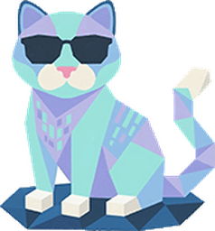

<h1 align="center">Totoro Chat</h1>

<a href="https://api.to-to.cc">Totoro API</a> 的网页聊天客户端 —— 一个 Key，畅聊 Claude、GPT、Gemini。

## 使用

1. 在 [Totoro API 控制台](https://api.to-to.cc/keys) 创建一个 API Key
2. 打开 Totoro Chat，粘贴 Key —— 自动验证并加载你能用的模型
3. 开始聊天

不用填 Base URL：默认走 `https://api.to-to.cc`，连不上时可在「设置 → 账户与模型」切到香港直连线路。

## 特性

- **自动识别协议**：Claude 走 Anthropic `/v1/messages`，Gemini 走 `/v1beta`，其余模型走 OpenAI 兼容的 `/v1/chat/completions`
- **多 Key 合并**：不同分组的 Key 可以同时添加，模型自动合并到一个列表
- **输入框里切模型**，一键开关「深度思考」；不同代际模型的思考参数自动适配
- **画图**：直接说「画一只猫」，对话模型会自动调用画图模型（gpt-image 等）；也可以打开「画图」开关直接出图，上传图片改图，或涂抹局部只改一块区域。接口遵循 OpenAI 官方 Images API（`/v1/images/generations`、`/v1/images/edits`）
- 流式输出 · Markdown / 代码高亮 / 数学公式 / Mermaid 图表
- 图片与文件输入（PDF / Word / 代码）· 场景对话（带长期记忆）· 记事本
- 浅色 / 深色主题 · 中 / 英界面 · 可安装为 PWA
- Key 和对话只保存在浏览器本地（对话和图片存 IndexedDB，不受 localStorage 5MB 限制；可带图片导出/导入）
- 侧栏可收起，聊天区域更宽

## 部署

纯静态页面，无需构建。推送到 `main` 后由 GitHub Actions 自动发布到 GitHub Pages（仓库 Settings → Pages → Source 选 **GitHub Actions**）；也可以把整个目录放到任意静态服务器。

浏览器会直接请求 Totoro API，所以网关需要为聊天站的域名开启 CORS，并允许这些请求头：`Authorization`、`Content-Type`、`x-api-key`、`anthropic-version`、`x-goog-api-key`。

## 致谢

基于开源项目 [lfbear/chatbox-lite](https://github.com/lfbear/chatbox-lite) 改造。
